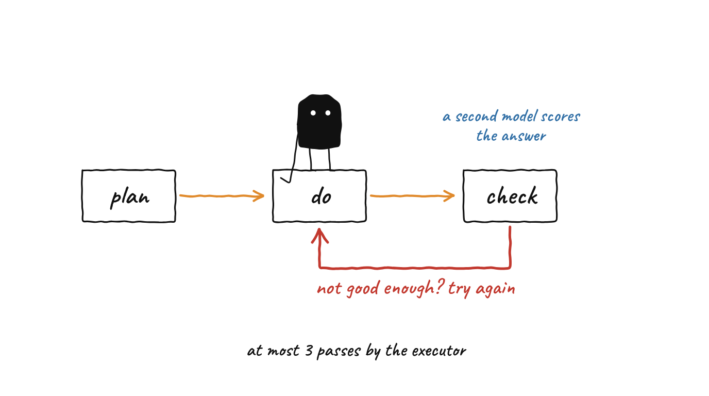
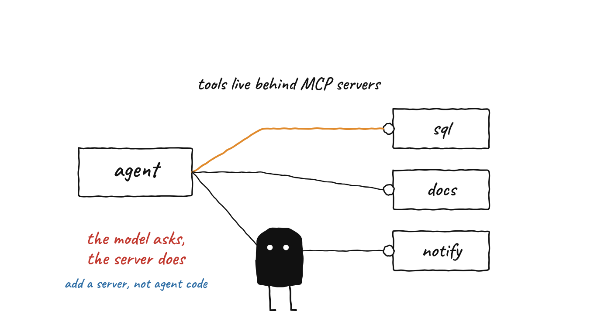
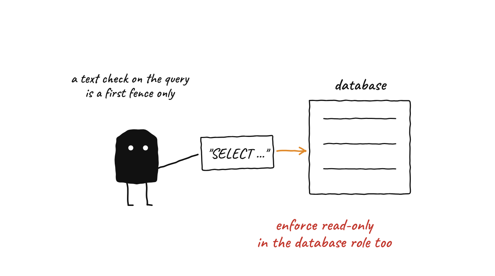
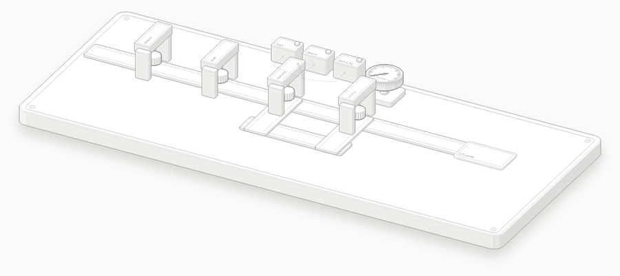

<div align="center">

# Enterprise Agentic AI Platform

**A planner, executor and critic loop built on LangGraph, with tools exposed through MCP servers, a RAG knowledge base, and a streaming FastAPI backend.**

    

[What this is](#what-this-is-and-is-not) · [Illustrated](#the-idea-illustrated) · [How it works](#how-it-works-start-to-finish) · [Quick start](#quick-start) · [Limitations](#limitations)

</div>

---

## The problem and the approach

A single "retrieve, then summarise" call struggles with tasks that need several steps: read a document, query a database, then tell someone. This project splits that work across specialised stages so each stage has one job and the tools are separate from the model.

1. **Memory** retrieves relevant chunks from a vector store.
2. The **planner** turns the task into at most six numbered steps.
3. The **executor** asks a model to pick tools, calls them on MCP servers, and writes an answer.
4. The **critic** scores the answer. If it is not good enough, the answer goes back to the executor with the critique.
5. The answer is returned over REST or streamed over a WebSocket.

The tools (SQL, documents, notifications) live in their own FastMCP servers, so adding a tool means adding a server rather than changing the agent graph.

## What this is and is not

Read this first. It is the honest scope of the repository, taken from reading the source code.

| What you might assume | What the code actually does |
|---|---|
| "Plans and executes multi-step actions" | The planner writes the steps, but the executor runs **one plan step per pass** (`state.plan[state.current_step]`) and then writes a final answer. Later steps run only if the critic asks for another pass. If the critic accepts after the first pass, the remaining steps never run. |
| "The critic revises the answer up to 3 times" | `MAX_REVISIONS = 3` is compared with `revision_count`, which the executor increments on **every** pass. That allows **three executor passes in total**, so at most two revisions after the first answer. |
| "Self-correction" | The critic is the same kind of model scoring its own pipeline's output. It returns a JSON score and a revise flag; if its reply cannot be parsed as JSON, the answer is **accepted as is**. |
| "Tools: GitHub, Notion, web search" | The planner prompt lists `search_knowledge_base`, `fetch_github`, `fetch_notion`, `web_search` and others. **Only the three MCP servers exist** (SQL, document, notification), and none of those listed names matches their tool names. The executor discovers the real tools from the servers at run time. |
| "Hybrid search with Cohere reranking" | Retrieval uses LlamaIndex with Qdrant hybrid mode, filters by a score threshold (0.7) and sorts by score. There is **no reranking model**; Cohere is not used anywhere in the code. |
| "Memory pulls conversation history" | The memory node runs a vector search on the task text (top 5 chunks). It does not read past conversation turns. |
| "OAuth 2.1 ready, enterprise-grade security" | There is **no authentication** on the endpoints. `user_id` is a free-text field defaulting to `anonymous`. |
| "Read-only SQL tool" | `query_database` checks only that the text **starts with `SELECT`**. It does not use a read-only database role, and it can read any table the connection can. `insert_record` writes to **any table name the model supplies**, with the table and column names placed directly into the SQL text. |
| "Checkpointed, durable state" | `main.py` and the REST route build the graph **without a checkpointer**. `create_graph_with_persistence()` exists but is not used. The graph is also compiled with `interrupt_before=["handle_error"]`. |
| "Deployed on EKS with CI/CD and ArgoCD" | CI runs a minimal lint and `pytest`; there are **no deploy jobs**, and ArgoCD is not configured. Terraform and Kubernetes files exist (EKS, VPC, RDS, ElastiCache, S3; a 3 to 20 replica HPA) but were not applied or tested here. |
| "LangSmith + Langfuse observability" | Tracing setup covers LangSmith and Prometheus metrics. `langfuse` is in `requirements.txt` and settings but is not used in the code. |
| "Next.js 14 + shadcn/ui" | The frontend imports `lucide-react` and `remark-gfm`, which are **not listed** in `frontend/package.json`, and shadcn/ui is not present. By reading the files, `npm install` followed by a build would fail on those imports. |

Also from reading the files, not from running them: the `celery-worker` service in `docker-compose.yml` points at `backend.core.celery_app`, which does not exist; the README's old ingest example used `-F "files=@..."` but the route expects a field named `file`; and `main.py` defines `/api/v1/agent/invoke` even though the agent router already provides it. The test suite has five tests, and they use a mocked model; they were not run for this README.

## The idea, illustrated

<p align="center">
  <br>
  <sub><b>Plan, do, check, and try again.</b> A second model scores the answer; the executor makes at most three passes.</sub>
</p>

<p align="center">
  <br>
  <sub><b>Tools live behind MCP servers.</b> The model asks; the server does the work.</sub>
</p>

<p align="center">
  <br>
  <sub><b>A recommendation, not current behaviour.</b> The SQL tool checks the text of the query. Give its database user read-only rights as well.</sub>
</p>

## The whole system in one picture

<p align="center">
  
</p>

| On the bench | In the platform | Code |
|---|---|---|
| Arch "memory" | Vector search for context on the task text | `backend/agents/memory.py`, `backend/rag/retriever.py` |
| Arch "plan" | Break the task into up to six numbered steps | `backend/agents/planner.py` |
| Arch "execute" and the three boxes | The executor lists tools on three MCP servers, lets the model choose, calls them, then writes an answer | `backend/agents/executor.py`, `backend/mcp_servers/` |
| Arch "critic" and its dial | The critic returns a score, a revise flag and feedback as JSON | `backend/agents/critic.py` |
| Return lane | `should_revise` sends the slip back to the executor while passes remain | `backend/agents/graph.py` |
| Tray "stream" | The final answer is returned by REST or streamed node by node over a WebSocket | `backend/main.py` |

Open [`docs/anatomy/agent-loop-bench-light.html`](docs/anatomy/agent-loop-bench-light.html) in a browser to scrub through it (details in [`docs/anatomy/README.md`](docs/anatomy/README.md)). Which tools fire, the plan and the needle positions are drawn for the picture; no real score is shown.

## How it works, start to finish

### Phase 1 · Ingest documents (optional)

`POST /api/v1/documents/ingest` takes one uploaded file (`.pdf`, `.txt`, `.md` or `.docx`) in a form field named `file`, splits it with LlamaIndex's `SemanticSplitterNodeParser`, embeds it with OpenAI `text-embedding-3-large`, and stores it in a Qdrant collection (`enterprise_knowledge` by default).

```bash
curl -X POST http://localhost:8000/api/v1/documents/ingest -F "file=@annual_report.pdf"
```

### Phase 2 · Run a task

| Step | Node | What it really does |
|---|---|---|
| **1. Retrieve** | `memory_retrieval` | Vector search on the task text; keeps up to 5 chunks scoring at least 0.7. |
| **2. Plan** | `planner` | Asks the model for up to six numbered steps. If none can be parsed, the whole task becomes one step. An empty plan routes to `handle_error`. |
| **3. Execute** | `executor` | Connects to the three MCP servers to list their tools, lets the model choose tools for the **current** plan step, calls them, then makes a second model call to write an answer from all tool results so far. |
| **4. Critique** | `critic` | Asks the model for a JSON score (0 to 10), a revise flag and feedback. A score of 7 or more should mean no revision. An unparseable reply accepts the answer. |
| **5. Loop or finish** | `should_revise` | If a revision is needed and fewer than three executor passes have run, go back to step 3 with the critique; otherwise finish. |
| **6. Respond** | FastAPI | `POST /api/v1/agent/invoke` returns the answer, confidence, citations and tool results. The WebSocket `/ws/agent/{thread_id}` streams a `node_update` message after each node. |

### MCP servers

| Server | Port | Tools |
|---|---|---|
| `postgres_mcp` | 8001 | `query_database`, `list_tables`, `insert_record` |
| `document_mcp` | 8002 | `extract_text_from_pdf`, `extract_tables_from_pdf`, `search_document` (each takes a file path on the server) |
| `notification_mcp` | 8003 | `send_slack_message`, `send_webhook` (to any URL), `create_slack_reminder` |

All three use the streamable HTTP transport.

## Stack

| Layer | Technology | Status in this repository |
|---|---|---|
| Orchestration | LangGraph | Used by `graph.py`; no checkpointer is attached by the API |
| LLM | Claude via `langchain-anthropic` (model name set in `config.py`) | Needs `ANTHROPIC_API_KEY` |
| Tools | FastMCP servers | Three servers, as above |
| RAG | LlamaIndex, Qdrant (hybrid), OpenAI embeddings | Needs `OPENAI_API_KEY` for embeddings |
| API | FastAPI with REST and WebSocket | No authentication |
| Frontend | Next.js 14, Zustand, React Markdown | Imports packages missing from `package.json` |
| Observability | LangSmith, Prometheus, Grafana | Langfuse is listed but unused |
| Infrastructure | Docker Compose (11 services), Kubernetes manifests, Terraform | Not applied or tested here; the Celery worker service has no module behind it |

## Quick start

Everything here comes from the source and the Makefile and has **not been run**.

```bash
git clone https://github.com/designer-coderajay/enterprise-agentic-ai-platform.git
cd enterprise-agentic-ai-platform
python -m venv venv && source venv/bin/activate
pip install -r requirements.txt
cp .env.example .env     # set ANTHROPIC_API_KEY, OPENAI_API_KEY, DATABASE_URL, SECRET_KEY
make dev-full            # Docker Compose stack
```

Or run pieces yourself: start each MCP server with `python backend/mcp_servers/<name>/server.py`, then `uvicorn backend.main:app --port 8000` from the repository root.

Example call:

```bash
curl -X POST http://localhost:8000/api/v1/agent/invoke \
  -H "Content-Type: application/json" \
  -d '{"task": "List the tables in the database and summarise what they hold"}'
```

## Project structure

```
enterprise-agentic-ai-platform/
├── backend/
│   ├── agents/         # state, graph, planner, executor, critic, memory
│   ├── rag/            # ingestion pipeline and retriever (LlamaIndex + Qdrant)
│   ├── mcp_servers/    # postgres_mcp, document_mcp, notification_mcp
│   ├── api/            # FastAPI routes (health, agent, documents)
│   ├── observability/  # LangSmith and Prometheus setup
│   └── main.py         # FastAPI app (REST and WebSocket)
├── frontend/           # Next.js chat UI with an agent trace sidebar
├── infra/              # Dockerfiles, Kubernetes manifests, Terraform
├── tests/              # five pytest-asyncio tests with a mocked model
├── docs/
│   ├── anatomy/        # the interactive bench figure (HTML, GIF, PNG) and its build files
│   └── illustrations/  # the README illustrations and their generator
├── docker-compose.yml
└── Makefile
```

## Limitations

- **Prototype.** No authentication, no checkpointer on the API path, no deploy pipeline.
- **Multi-step plans are not fully executed** unless the critic keeps asking for another pass (see the table above).
- **The SQL tool is not safely read-only.** Use a read-only database role, restrict the writable tables or remove `insert_record`, and treat model-written SQL as untrusted.
- **The document and webhook tools take model-chosen inputs.** A file path on the server and a URL to call are both supplied by the model; restrict them before exposing this to users.
- **The critic is a model, not a test.** It can accept a wrong answer.
- **Costs.** One task can make many model calls (planner, executor with tools, a synthesis call, the critic, per pass).
- **Not run here.** This README was checked against the source code, not by running the system; the five tests were not run either.

## Skills demonstrated

Multi-agent workflow design with LangGraph · conditional routing and feedback loops · tool abstraction with MCP · RAG with LlamaIndex and Qdrant · FastAPI REST and WebSocket streaming · Docker Compose, Kubernetes and Terraform authoring

## License

No licence file is included in the repository.
